# Euclis WhatsApp Integration

Complete reference for the WhatsApp bot: architecture, files, env vars, database, flows, and common change points.

**Webhook URL:** `https://<host>/api/webhooks/whatsapp`

---

## What it is

WhatsApp is a **thin adapter** over the same service layer as the web dashboard and Claude MCP. Users message a Meta Cloud API bot number; the webhook resolves **phone → user**, runs **Claude Haiku 4.5** with tool-use for text, or uploads media directly. Changes hit **Postgres via Prisma** and the web dashboard updates via **Supabase Realtime** (`revalidateUserWorkspaces`).

---

## Architecture

```mermaid
sequenceDiagram
  participant User as User (WhatsApp)
  participant Meta as Meta Cloud API
  participant Webhook as /api/webhooks/whatsapp
  participant Dedup as WhatsAppInboundDedup
  participant Queue as WhatsAppInboundQueue
  participant Lock as WhatsAppProcessingLock
  participant Handler as processQueuedMessage
  participant AI as Claude Haiku 4.5
  participant Services as lib/services/project.ts
  participant DB as Postgres

  User->>Meta: text / image / document
  Meta->>Webhook: POST (signed)
  Webhook->>Webhook: verifyMetaSignature
  Webhook->>Dedup: claimInboundMessage(wamid)
  Webhook->>Queue: enqueueInboundMessage (per phone FIFO)
  alt queueDepth > 1
    Webhook->>User: "Queued. N messages ahead..."
  end
  Webhook->>Queue: ensureQueueProcessed (one drain per phone)
  Queue->>Lock: tryAcquireProcessorLock
  Queue->>Handler: process one message at a time
  alt text
    Handler->>Handler: getUserIdByPhone, greeting/tag fast-paths
    Handler->>AI: history + tools (up to 16 turns)
    AI->>Services: create_task, update_task, etc.
    Handler->>User: summary reply
    Handler->>DB: recordExchange (WhatsAppMessage)
  else media
    Handler->>Services: uploadAsset
    Handler->>User: confirmation
  end
```



---

## File map

| File | Role |
|------|------|
| `app/api/webhooks/whatsapp/route.ts` | **Main brain**: GET verify, POST pipeline, Haiku loop, tool execution |
| `lib/whatsapp.ts` | Meta Graph API: send text, mark read, verify signature, parse inbound, download media |
| `lib/whatsapp-bot.ts` | Bot number helpers, `WHATSAPP_START_MESSAGE = "hi"`, greeting regex, `wa.me` deep link |
| `lib/whatsapp-queue.ts` | Per-phone FIFO queue + drain loop |
| `lib/whatsapp-inbound.ts` | wamid dedup + processor lock |
| `lib/whatsapp-progress.ts` | "Got it. Working on that now..." + throttled step pings |
| `lib/whatsapp-webhook-log.ts` | Debug logging (`WHATSAPP_WEBHOOK_DEBUG=1`) |
| `lib/services/conversation.ts` | Rolling chat memory + `whatsappChatInitiatedAt` |
| `lib/identity-cache.ts` | Cached `phone → userId` (60s TTL) |
| `lib/services/project.ts` | **Shared actions**: tasks, board, assets, `resolveUserWorkspaceContext` |
| `lib/services/workspace.ts` | `updateUserPhone`, `findOrCreateWorkspaceByName` |
| `lib/actions/settings.ts` | `updatePhoneAction` server action |
| `components/integrations/integrations-prompt.tsx` | Dashboard onboarding card (WhatsApp + Claude tabs) |
| `components/settings/phone-form.tsx` / `settings/phone-number-input.tsx` | Phone linking UI with country picker |
| `components/whatsapp/whatsapp-bot-number.tsx` | Settings bot number + "Send hi on WhatsApp" |
| `components/whatsapp/whatsapp-onboarding-sync.tsx` | Refreshes UI when user returns from WhatsApp tab |
| `components/layout/app-shell.tsx` | Hides integrations prompt if `userHasInitiatedWhatsAppChat` |
| `scripts/unstick-whatsapp-queue.sql` | Manual recovery for stuck queue |
| `SETUP.md` §3 | Meta setup instructions |

---

## Environment variables

From `.env.example`:

```env
ANTHROPIC_API_KEY=...              # Haiku only (WhatsApp path)
WHATSAPP_VERIFY_TOKEN=...          # Meta webhook handshake
WHATSAPP_ACCESS_TOKEN=...          # Graph API bearer
WHATSAPP_PHONE_NUMBER_ID=...       # NOT the phone number — Meta API Setup ID
NEXT_PUBLIC_WHATSAPP_BOT_NUMBER=... # E.164 digits, no + (user-facing)
WHATSAPP_APP_SECRET=...            # HMAC signature verification
WHATSAPP_WEBHOOK_DEBUG=1           # Verbose logs (auto on in dev)
```

**Common pitfall:** `WHATSAPP_PHONE_NUMBER_ID` must match `metadata.phone_number_id` in webhook payloads or sends fail.

---

## Database models (Prisma)

```prisma
User.phone                    String? @unique   // E.164 digits, no +
User.whatsappChatInitiatedAt  DateTime?         // first inbound message

WhatsAppInboundDedup          messageId PK      // Meta wamid dedup
WhatsAppProcessingLock        phone PK          // one drain loop per phone
WhatsAppInboundQueue          FIFO per phone    // status: pending|processing|done|failed
WhatsAppMessage               userId, role, content  // conversation memory
```

**Migrations:**

- `20260613090000_whatsapp_inbound_dedup`
- `20260613103000_whatsapp_processing_lock`
- `20260613120000_whatsapp_inbound_queue`
- `20260611074804_whatsapp_conversation_history`
- `20260626160000_whatsapp_chat_initiated`

---

## Identity and phone linking

1. User saves phone in **Settings** or **integrations prompt** → `updateUserPhone()` in `lib/services/workspace.ts`
2. Format: `/^[1-9]\d{7,14}$/` (country code + national, no `+` or spaces)
3. UI splits country code + local number via `lib/phone-countries.ts` + `PhoneNumberInput`
4. **One phone = one account** (unique constraint)
5. Meta sends `message.from` as E.164 without `+` — must **exactly match** stored `User.phone`
6. Lookup: `getUserIdByPhone(from)` in `lib/identity-cache.ts` (invalidate on phone change)

---

## Inbound POST pipeline (`route.ts`)

1. **Verify** `X-Hub-Signature-256` with `WHATSAPP_APP_SECRET`
2. **Parse** first message via `extractInboundMessage` (text | image | document only)
3. **Dedup** `claimInboundMessage(messageId)` — Meta retries aggressively
4. **Enqueue** `enqueueInboundMessage` → returns `{ depth, mode }`
   - If queue table missing → `mode: "direct"` (no queue)
5. If `queueDepth > 1` → send **"Queued. N messages ahead..."**
6. **Mark read** (blue ticks) — fire-and-forget
7. **Process** via `ensureQueueProcessed(phone, processQueuedMessage)` — must be awaited (not background)
8. Always return `200 { status: "ok" }` after step 7 (errors → WhatsApp text to user)

### Queue behavior

- **One message at a time per phone number**
- `WhatsAppProcessingLock` prevents parallel drains
- Stale lock recovery after 60s (`PROCESSOR_STALE_MS`)
- Heartbeat every 15s during long Haiku runs
- Manual unstick: `scripts/unstick-whatsapp-queue.sql`

---

## Message handling paths

### Unlinked user

- Greeting (`hi`, `hello`, etc.) → `UNLINKED_GREETING_REPLY`
- Other → `DENIED_MESSAGE` (sign in, add number in Settings)

### Linked user — fast paths (no Haiku)

1. **Greeting** (`isWhatsAppGreeting`) → `linkedGreetingReply(workspaceName)`
2. **Asset tagging** is handled by the Haiku tool `update_asset_tags` → `updateAssetTagsByRef`

### Linked user — text (Haiku agentic loop)

- Model: `claude-haiku-4-5`
- Loads `getRecentConversation(userId)` — last **12 turns / 2 hours**
- Up to **16 tool rounds** (`MAX_TOOL_TURNS`)
- Tools → `executeAction()` → same services as web/MCP
- Summary built by `buildDeterministicSummary` (not model free text when tools ran)
- `WhatsAppProgress` sends step updates every 2.5s on multi-step requests

### Media (image/document)

- No Haiku — direct `uploadAsset`
- Caption: comma tags; `#N` attaches to task #N
- Reply confirms filename, workspace, task, tags

### All linked inbound paths call

- `markWhatsAppChatInitiated(userId)` on first message
- `recordExchange(userId, userText, reply)` after reply

---

## Haiku tools (`TOOLS` array in `route.ts`)

| Tool | Service |
|------|---------|
| `create_task` | `createTask` + optional `updateTask` for assignee |
| `update_task` | `updateTask` (by shortId; batch ordinal mapping) |
| `delete_task` | `deleteTask` |
| `get_board_state` | `getBoardState` |
| `create_workspace` | `findOrCreateWorkspaceByName` |
| `update_asset_tags` | `updateAssetTagsByRef` |

### Workspace resolution (`resolveUserWorkspaceContext`)

1. Explicit `workspace` hint from user/model
2. `User.lastActiveWorkspaceId`
3. Single membership
4. Most recently joined

After mutations: `revalidateUserWorkspaces(userId, workspaceId)` so dashboard Realtime refreshes.

---

## User-facing copy (key strings)

| When | Message |
|------|---------|
| Unlinked | "This WhatsApp number isn't linked..." |
| Unlinked hi | "Hey! I'm the Euclis bot. To get started..." |
| Linked hi | "Hey! You're connected to Euclis (WorkspaceName)..." |
| Queue backlog | "Queued. N messages ahead..." |
| Processing start | "Got it. Working on that now..." |
| Queued processing | "Working on your next queued message..." |
| Media queued | "Processing your queued file upload..." |
| Error | "Something went wrong on our side..." |

Start message for onboarding: **`hi`** → `wa.me/<bot>?text=hi`

---

## Web UI integration

### Integrations prompt (`components/integrations/integrations-prompt.tsx`)

- Shown in app shell until dismissed (localStorage) **or** `whatsappChatInitiatedAt` is set
- WhatsApp tab: link phone, Step 2 "Send hi on WhatsApp" deep link
- Claude tab: MCP connector URL

### Settings (`app/(app)/settings/page.tsx`)

- Bot number display + phone form
- `updatePhoneAction` → `revalidatePath("/", "layout")`

### Onboarding sync

- `WhatsAppOnboardingSync`: `visibilitychange` → `router.refresh()` so prompt hides after user sends hi

---

## Debugging

```bash
# Local verbose logs
WHATSAPP_WEBHOOK_DEBUG=1 npm run dev

# Production logs (from package.json)
npm run vercel:logs:whatsapp

# Unstick queue manually
psql ... -f scripts/unstick-whatsapp-queue.sql
```

Log prefixes: `[whatsapp-webhook]`, `[whatsapp-queue]`

### Checklist when bot doesn't reply

1. Phone linked in Settings matches Meta `from` exactly
2. `WHATSAPP_PHONE_NUMBER_ID` matches webhook metadata
3. Tester number added in Meta API Setup (test mode)
4. `ANTHROPIC_API_KEY` set
5. Queue not stuck (run unstick SQL)
6. Restart dev server after `prisma migrate` (stale client)

---

## Shared layer (not WhatsApp-specific)

All real business logic lives in:

- `lib/services/project.ts` — tasks, board, assets
- `lib/services/workspace.ts` — workspaces, phone, usernames

WhatsApp webhook should stay thin: parse → authorize → call services → reply.

MCP equivalent: `app/api/mcp/route.ts` (same services, bearer token auth instead of phone).

---

## Common change points

| Goal | Edit |
|------|------|
| Change bot personality / tool rules | `buildSystemPrompt()` in `route.ts` |
| Add new bot capability | Add tool to `TOOLS` + case in `executeAction()` |
| Change greeting / error messages | Constants at top of `route.ts` |
| Change queue behavior | `lib/whatsapp-queue.ts` |
| Change onboarding UI | `integrations-prompt.tsx`, `app-shell.tsx` |
| Change phone validation | `PHONE_REGEX` + `updateUserPhone` in `workspace.ts` |
| Meta send/read API | `lib/whatsapp.ts` |
