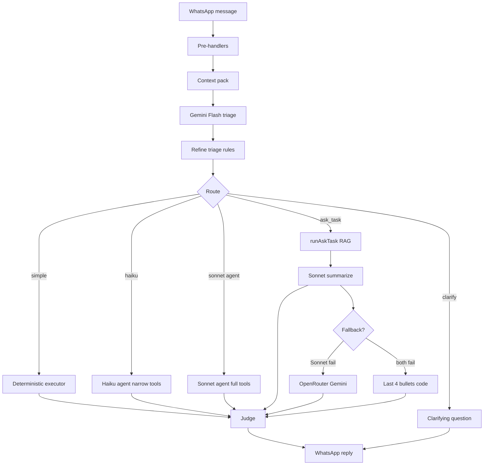

# WhatsApp Orchestration Layer — Architecture & Roadmap

Reference for discussing Euclis WhatsApp bot design: multi-step routing, model roles, reliability, and future work.

**Last updated:** July 2026  
**Status:** Orchestrator behind `WHATSAPP_ORCHESTRATOR=1` on production (`euclis.dev`)

---

## 1. Problem we’re solving

Early WhatsApp flow: **one Haiku agent** with ~35 tools, free-form replies, optional Sonnet polish.

**Failure modes at scale:**

| Symptom | Root cause |
|--------|------------|
| “I can’t post updates from chat” | Model improvised instead of calling `add_task_update` |
| `#1 Seo Queries` in user text | Haiku summary overrode formatted tool output |
| Duplicate “I need the update message” | Parallel tool calls + weak body resolution |
| Full 20-update dump on WhatsApp | RAG pack sent directly to user |
| Wrong task on “work on seo queries” | Stale `#N` in history beat explicit task name |

**Principle:** Code owns **truth** (tools, formatters, task resolution). Models own **classification** and **compression** — not capabilities or receipts.

---

## 2. High-level pipeline

```
WhatsApp message
       │
       ▼
┌──────────────────────────────────────┐
│ 0. PRE-HANDLERS (code, no LLM)       │
│    Greeting, workspace picker,       │
│    interactive buttons, media upload │
└──────────────────────────────────────┘
       │
       ▼
┌──────────────────────────────────────┐
│ 1. CONTEXT PACK (code, free)         │
│    Board titles, last 8 turns,       │
│    last task hints, workspace name   │
└──────────────────────────────────────┘
       │
       ▼
┌──────────────────────────────────────┐
│ 2. TRIAGE (Gemini Flash @ OpenRouter)│
│    JSON: intent, complexity, slots,  │
│    confidence, clarifying_question   │
└──────────────────────────────────────┘
       │
       ▼
┌──────────────────────────────────────┐
│ 2b. REFINE TRIAGE (code)             │
│    Rules: ask_task, read_task,         │
│    post_update guards, switch workspace│
└──────────────────────────────────────┘
       │
       ├── clarify (low confidence) ──► one question
       │
       ├── simple ──► DETERMINISTIC EXECUTOR (no agent)
       │              board / create / update / post / focus task
       │
       ├── ask_task ──► RAG (code) ──► Sonnet SUMMARIZE ──► judge
       │
       ├── haiku ──► narrowed tool agent (simple ambiguous)
       │
       └── sonnet ──► full tool agent (compound / admin)
       │
       ▼
┌──────────────────────────────────────┐
│ 3. JUDGE (rules + Gemini Flash)      │
│    approve | fix | reject_use_tools  │
└──────────────────────────────────────┘
       │
       ▼
   User message (+ optional buttons)
```

---

## 3. Model roles & cost

| Step | Model | Provider | Job |
|------|--------|----------|-----|
| **Triage** | `google/gemini-2.5-flash` | OpenRouter | Intent + complexity JSON |
| **Simple execute** | None | Code | Board, CRUD, post update |
| **ask_task RAG** | None | Code + embeddings | `buildTaskContextPack` |
| **ask_task summarize** | `claude-sonnet-4-5` | Anthropic | 3–6 sentence answer from pack |
| **Summarize fallback** | Gemini Flash | OpenRouter | If Sonnet fails |
| **Summarize last resort** | None | Code | Last 4 update bullets |
| **Agent (simple)** | `claude-haiku-4-5` | Anthropic | Narrow tool set |
| **Agent (complex)** | `claude-sonnet-4-5` | Anthropic | Full tool set |
| **Judge** | Gemini Flash | OpenRouter | Safety + format gate |

**Design rule:** Sonnet for **ask_task** = summarizer only (reads pack, writes prose). Sonnet agent = compound mutations only — not status Q&A.

---

## 4. Intent contract

Stable enum used across triage, routing, and execution:

| Intent | Route | Execution |
|--------|-------|-----------|
| `board_list` | simple | `getBoardState` → formatter |
| `create_task` | simple | `createTask` |
| `update_task` | simple | `updateTask` (status, etc.) |
| `post_update` | simple | `add_task_update` |
| `read_task` | simple | Acknowledge task focus (“Got it — *Title*…”) |
| `ask_task` | sonnet path | RAG → summarize |
| `delete_task` | haiku/sonnet | Staged confirm buttons |
| `compound` | sonnet | Multi-tool agent |
| `workspace_admin` | haiku/sonnet | switch, invite, etc. |
| `unknown` | clarify or haiku | Ask or agent fallback |

**Slots** (optional JSON fields): `task_ref`, `task_title`, `body`, `status`, `title`, `query`

---

## 5. Task resolution (context vs explicit name)

| User says | Resolver |
|-----------|----------|
| **Names task** — “work on seo queries” | `resolveWhatsAppTaskByTitle()` — title in **this** message wins |
| **Progress, no name** — “I started 2 reddit posts” | Conversation context + `lastDiscussedTaskShortId` |
| **Affirmation** — “yes post that” | Pull body from prior assistant offer |
| **Ambiguous** | `formatTaskPickPrompt` — titles only, no `#N` |

Workspace context (active workspace, board list in triage pack) is always included. Title match does **not** replace workspace — it only disambiguates **which task** within that workspace.

---

## 6. User-facing copy

- **Title-first:** `*Seo Queries*` not `#1 Seo Queries`
- **Tool output wins** over Haiku assistant note for mutations
- **Formatters:** `lib/channel-formatters.ts`, `lib/whatsapp-voice.ts`, `lib/whatsapp-task-ref.ts`
- **Judge blocks:** “can’t post from chat”, `#N` in board text, full `Updates (N):` dumps

---

## 7. File map (orchestrator)

| File | Role |
|------|------|
| `lib/whatsapp-orchestrator/index.ts` | Main orchestrator entry |
| `lib/whatsapp-orchestrator/triage.ts` | Gemini Flash intent JSON |
| `lib/whatsapp-orchestrator/refine-triage.ts` | Code corrections after triage |
| `lib/whatsapp-orchestrator/context-pack.ts` | Board + history for triage/judge |
| `lib/whatsapp-orchestrator/execute-simple.ts` | Deterministic intents |
| `lib/whatsapp-orchestrator/summarize-ask-task.ts` | Sonnet/OpenRouter/fallback summary |
| `lib/whatsapp-orchestrator/judge.ts` | Rules + LLM verification |
| `lib/whatsapp-orchestrator/tools-for-intent.ts` | Narrow Haiku tool sets |
| `lib/whatsapp-orchestrator/types.ts` | Intents, env flags, models |
| `lib/openrouter.ts` | OpenRouter chat client |
| `lib/whatsapp-agent-loop.ts` | Haiku/Sonnet tool loop |
| `lib/whatsapp-tool-guard.ts` | Preflight + task resolution |
| `app/api/webhooks/whatsapp/route.ts` | Webhook; gates on `WHATSAPP_ORCHESTRATOR` |

Legacy (still present when orchestrator off):

- `lib/whatsapp-fast-path.ts` — glue; **do not extend**
- `lib/whatsapp-sonnet-polish.ts` — cosmetic polish; superseded by judge + summarize for ask_task

---

## 8. Environment variables

```bash
# Core
ANTHROPIC_API_KEY=...
OPENROUTER_API_KEY=...          # Triage + judge + summarize fallback

# Orchestration
WHATSAPP_ORCHESTRATOR=1         # Enable multi-step pipeline
WHATSAPP_JUDGE=1                # Verification layer (default on with orchestrator)
WHATSAPP_WEBHOOK_DEBUG=1        # Verbose logs on Vercel (required in prod)

# Models (optional)
WHATSAPP_TRIAGE_MODEL=google/gemini-2.5-flash
WHATSAPP_JUDGE_MODEL=google/gemini-2.5-flash
WHATSAPP_SIMPLE_MODEL=claude-haiku-4-5
WHATSAPP_COMPLEX_MODEL=claude-sonnet-4-5
WHATSAPP_SIMPLE_CONFIDENCE=0.82

# ask_task
WHATSAPP_ASK_TASK_SUMMARIZE=1   # Default on; set 0 to send raw RAG pack (debug only)

# Legacy / optional
WHATSAPP_SONNET_POLISH=0        # Prefer off when orchestrator on
WHATSAPP_TOOL_SEARCH=1          # Deferred tools for Haiku agent path
```

---

## 9. Debugging on Vercel

```bash
npm run vercel:logs:whatsapp        # Last 100 WhatsApp logs
npm run vercel:logs:whatsapp:live   # Live tail, grep webhook/orchestrator
```

**Log lines to watch:**

```
[orchestrator] triage { intent, complexity, confidence }
[orchestrator] route simple|haiku|sonnet|clarify ...
[orchestrator] ask_task summarizing { inChars }
[orchestrator] ask_task summarized { via: sonnet|openrouter|fallback }
[orchestrator] judge approve|fix|reject_use_tools
[whatsapp-webhook] orchestrator { route, intent, judge }
```

**Ignore:** `POST ignored — status update` (Meta delivery receipts)

---

## 10. Smoke test checklist

| # | Message | Expected route | Expected behavior |
|---|---------|----------------|-------------------|
| 1 | What's on my board | `simple` / board_list | Title-first sections, no `#N` |
| 2 | I want to work on seo queries | `simple` / read_task | “Got it — *Seo Queries*…” not Posted on |
| 3 | I have started 2 reddit posts | `simple` / post_update | Posted on *Task* |
| 4 | What's going on with the stress test | `sonnet` / ask_task | Short summary, not 20 updates |
| 5 | Mark seo queries done | `simple` / update_task | Updated *Seo Queries* → done |
| 6 | Add task review Q3 budget | `simple` / create_task | Added *Title* + status buttons |

---

## 11. Current limitations

1. **Switch workspace** — triage sometimes `unknown`; refine rules improving
2. **Judge LLM** — can be wrong; deterministic rules added for ask_task dumps
3. **Sonnet summarize** — must deploy latest code; logs must show `ask_task summarized`
4. **Compound requests** — still agent-heavy; highest hallucination risk
5. **No CI golden tests** — regressions caught manually via smoke test
6. **No triage observability DB** — intent/confidence only in logs

---

## 12. Future roadmap

### Phase A — Stability (next)

- [ ] **Golden conversation evals in CI** — scripted threads; assert intent, tools, no forbidden phrases
- [ ] **Triage observability** — log `intent`, `confidence`, `route`, `judge` to DB or structured analytics
- [ ] **Expand simple executor** — `switch_workspace`, staged `delete_task` where confidence high
- [ ] **Remove legacy fast-path** once orchestrator default in prod

### Phase B — Intent planner (medium)

Replace “Haiku picks from 35 tools” with:

```
user message → Intent JSON (Gemini) → executeIntent() → fixed service calls
```

- Haiku/Sonnet only for **compound** and **open-ended Q&A**
- All mutations go through typed handlers — testable without LLM

### Phase C — Product (later)

- [ ] **Per-task thread UX** — optional “show full updates” vs summary
- [ ] **Caption attach by task name** (not only `#N`)
- [ ] **Proactive notifications** — assignment pings (24h window)
- [ ] **Latency budget** — parallel triage + context pack; typing indicator refresh

---

## 13. Architecture diagram (Mermaid)



---

## 14. Decision log (for discussions)

| Decision | Rationale |
|----------|-----------|
| Gemini via **OpenRouter** for triage/judge | Cheap, fast, structured JSON; reuse existing `OPENROUTER_API_KEY` |
| **Not** fast-path regex router as primary | Whack-a-mole; replaced by intent contract + refine rules |
| **ask_task:** RAG in code, summary in Sonnet | Facts from DB/embeddings; model only compresses |
| Judge **rejects** full pack to user | WhatsApp is not a dashboard |
| Title match when user **names** task | Explicit mention beats stale chat `#N` |
| Context for **vague** follow-ups | “I started…” needs last discussed task |
| Tool output **over** assistant note | Prevents `#N` summaries and fake capabilities |

---

## 15. Related docs

- `docs/whatsapp-integration.md` — Webhook, queue, Meta setup, legacy Haiku loop
- `.env.example` — All WhatsApp env vars
- `lib/retrieval/` — Task embeddings and RAG for `ask_task`

---

*Download: this file lives at `docs/whatsapp-orchestrator-architecture.md` in the repo.*
